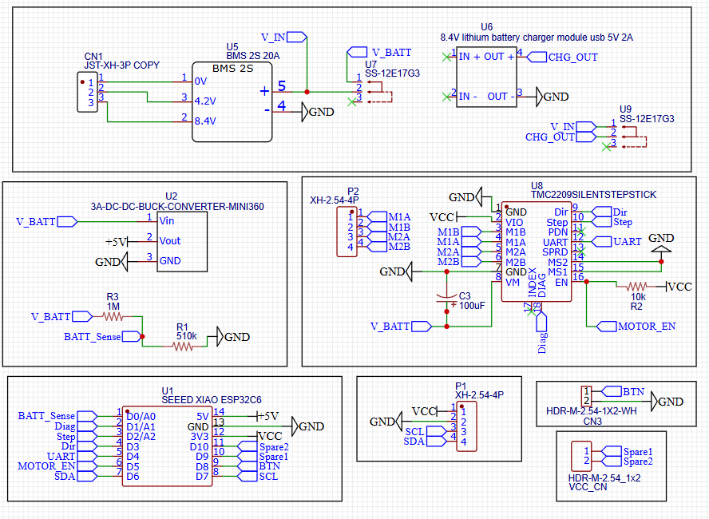
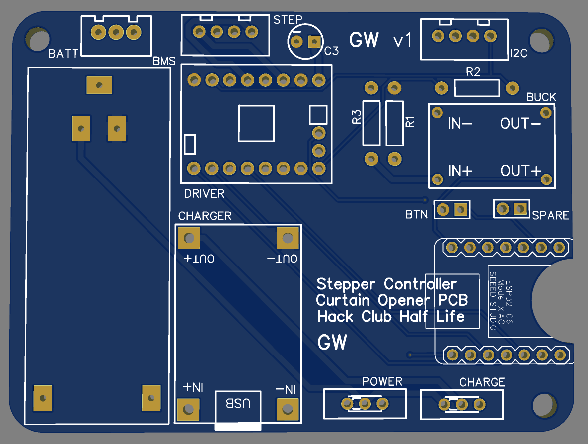
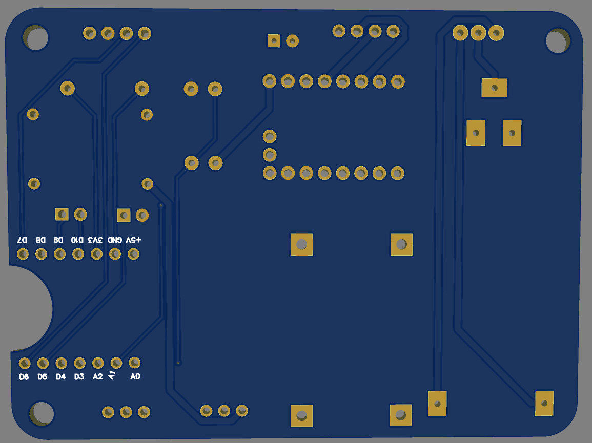

# Curtain Opener (PCB)

This is a project to create a simple PCB to link a microcontroller to various peripherals to automatically open and close a curtain.

## Repo Info
Contains the PCB design files and documentation for the creation of a PCB to control a stepper motor which is designed to open curtains with a pull cord. Will be linked to another repo at some point which will house the 3D design files.

## Use Case
The PCB will be for an attachment to replace the curtain cord tensioner to automatically open and close the curtain.

## PCB
Is a fairly simple PCB, with battery input from a 2S Li Ion pack, which powers a stepper motor and an ESP32. From my rough estimates, it should last esaily for 4 months without a charge, and with better optimisation likely much longer.

---

Again, a relatively simple PCB, without that many connections.
| | |
| --- | --- |
|  |  |